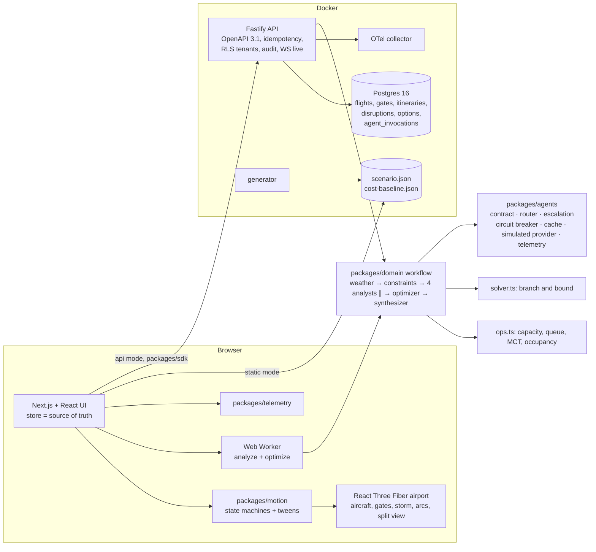

# AETHER: autonomous airport disruption recovery

A 3D airport digital twin where a weather agent, four parallel analysts, a real gate solver and a synthesizer recover an
airport from a thunderstorm, and a dispatcher approves the plan. The public site opens on a night airport (aircraft taxi, ground
vehicles move), a storm closes runway capacity and the delay ripples from the runway to the gates and the passengers; then the
workflow runs: a weather agent turns the feed into bounded capacity, four analysts work in parallel on their own slices, an
optimizer agent calls a branch-and-bound gate solver for three strategies, and a synthesizer that only ever sees compact
structured results compares them. Plans are compared in a **synchronized split view**, a 90-minutes-either-side **timeline
scrubber** replays the day, and approving a plan makes it the schedule on the airport.

Built from blueprint 02 of the *Claude Code Multi-Agent + Motion UI Engineering Build Book (Volume VI)* as a **vertical slice**:
the section 17 demo is built end to end on the book's stack, with the parts not built listed under
[Not built, and why](#not-built-and-why).

**Everything is synthetic.** The airport (NVK, "Norrvik"), airlines, tails, cities, passengers, ground fleet and weather feed are
generated by `data/simulators/generate.ts`. **No model is called anywhere.** Each application agent is a deterministic analyzer;
the provider layer charges it simulated tokens by the size of what went in and came out, at a configured price table, and
simulates latency and provider failures. Routing, escalation, retries, circuit breaking, caching, the Appendix C cost telemetry
**and the gate solver** are real code paths, exercised by tests.

- Live sandbox (static, runs entirely in your browser): https://mrrishit909.github.io/projects/aether-airport-recovery/demo/
- 2 min 30 s captioned recording of the whole scenario: [`docs/video/demo.mp4`](docs/video/demo.mp4)
- Case study: https://mrrishit909.github.io/projects/aether-airport-recovery/

## Run it

```bash
docker compose up --build -d --wait   # web :8541, API :8540, Postgres :55540, mail sink :8542, OTel collector, generator
make test                             # 68 unit + agent + API contract tests with coverage, against a throwaway Postgres
make agent-contract-test              # only the contract / routing / escalation / chaos / solver tests (no database)
make e2e                              # 9 Playwright journeys against the static export (needs Google Chrome)
make load-test                        # HTTP concurrency + 2,000 WebSocket streams against a running API (RATE_LIMIT=1000000)
make seed | make reset | make record  # regenerate data / wipe and reseed / re-record the demo video
```

Open http://localhost:8541. This is the same site as the public sandbox, but built to call the API, which runs both workflow
phases server-side, persists findings, options, gate assignments and `agent_invocations`, streams progress over a WebSocket and
writes the audit log. The demo tokens are local-only: `norrvik-dispatcher-demo`, `norrvik-viewer-demo` and
`halden-dispatcher-demo` (a second tenant with no airport, used to test isolation). The static sandbox needs no backend:
`npm ci && node data/simulators/generate.ts && npm run build -w @aether/web && node scripts/serve.ts`.

## The demo, step by step (blueprint section 17)

1. **Trigger the simulated thunderstorm.** One button (or `T`). A ripple runs from the runway to the gates and the passenger
   network. The runway turns red: capacity falls to 1 movement per 5 minutes (27% of nominal) for 45 minutes, then recovers one
   movement per bucket. Nothing has been optimized yet.
2. **Watch capacity fall and delays propagate.** A deterministic queue serves every movement through the reduced slots and
   carries the delay through each aircraft rotation (late inbound, late outbound, gate still occupied): 19 of 90 movements
   run more than 15 minutes late, and arrivals circle in a holding pattern. Press Play: the scene is a pure function of event
   time (`packages/domain/src/sim.ts`), so scrubbing and replaying are the same thing.
3. **Run the parallel agents.** The raw window is 12,990 tokens of schedules, manifests and telemetry. The weather agent
   (haiku) reads 1,323; flight risk, gate, passenger and ground-ops analysts (sonnet) read 6,600, 10,080, 9,582 and 3,445. They
   produce 35 findings: 13 gate conflicts, 3 turnaround failures, the lightning ramp stop, resource peaks, 8 misconnection
   cohorts. The passenger agent is only 55% sure about the cross-terminal connections (it lacks the terminal transfer table),
   so that subproblem, **4,443 tokens, not 9,582**, is escalated to opus. Opus finds the one 5-passenger C→B connection the
   generic minimum connection time calls "made" (gap 50, real need 51): the analysis says **101** misconnected, not the cheap
   tier's 96.
4. **Generate three solver-backed plans** (plus the do-nothing reference). The optimizer agent never solves a schedule in prose:
   it calls the gate solver per strategy. The synthesizer reads 1,780 tokens of structured option results.

   | | Misconnected (vulnerable) | Total delay | Gate changes | Holds | Solver |
   |---|---|---|---|---|---|
   | W · wait for gates (reference) | 101 (17) | 1,298 min | 0 | 21 | none |
   | A · minimum total delay | 128 (17) | **1,088 min** | 9 | 9 | best found, 8,001 nodes |
   | **B · protect connections (recommended)** | **17 (2)** | 1,273 min | 11 | 19 | best found, 8,001 nodes |
   | C · least disruption | 121 (17) | 1,228 min | **1** | 12 | best found, 8,001 nodes |

5. **Compare passenger and operational impact in a synchronized split view.** Two canvases, one clock, one camera, one plan each,
   with the lost-connection arcs drawn between gates, and a table of every metric with the better value marked.
6. **Approve a plan and watch the airport update.** Approval refuses until the policy flags (vulnerable passengers
   misconnecting, a 62-minute delay, solver not proven optimal, resources over capacity) are confirmed, then option B becomes the
   plan: the 11 gate changes animate, the replay runs the approved schedule, and the dispatch order is exported (hashed; in
   Docker it also writes the gate assignments and the hash-chained audit log).
7. **Replay the full event timeline.** The scrubber spans T−90 to T+90 minutes around the storm, with the capacity curve, the
   storm band and delay density under it. Deep link: `?run=1&opt=A&cmp=A,B&t=2026-10-07T09:20:00Z&cam=gates`.

Cost of the run at list prices: **$0.43** (haiku $0.0027, sonnet $0.21, opus $0.21; the two opus calls are 49% of it).

## Architecture



| Piece | What it does |
|---|---|
| `packages/agents` | The Agent Contract Standard (section 9) as a JSON schema plus a hand-written checker the browser can bundle (a test proves they agree on 12 malformed outputs). `Runtime.invoke()`: cache → circuit breaker → attempts with backoff on 429/500/timeout → contract validation → Appendix C row → escalate the *compact* subproblem one tier when confidence is below the agent's threshold or attempts are exhausted (climbing a tier only for provider failures, never for a malformed answer); the stronger answer is merged with the cheaper model's confident findings, or discarded if it is no better. `summarize()` builds the Appendix C dashboards. |
| `packages/domain` | Seeded scenario generator; `ops.ts`, the deterministic constraint builder (capacity from weather under the airport's operating rules, a 5-minute slot queue that propagates delay through rotations, minimum connection times by gate pair, gate occupancy and conflicts, ground-resource peaks, ramp closures); `solver.ts`, the gate solver; the analysts; the synthesizer; `sim.ts`, aircraft poses as a pure function of event time; `analyze()` and `optimize()`. Flight remarks are only ever compared, counted or copied: no text from the feed can become an instruction. |
| The gate solver | Each rotation picks (gate, hold) from a finite domain; no two rotations may overlap on a gate (hard), gates must be compatible and open (hard); the objective is a weighted sum of gate changes, remote-stand passengers, holds and *marginal misconnections* (exact for the pair, counterparts at their queued times). Depth-first branch and bound with fail-first variable ordering, forward-checked bound, a warm start from the wait-for-gates plan, and a node cap that makes the answer "best found" and says so in the metadata. |
| `packages/motion` | Deterministic state machines and an orchestrator that tweens values on an explicit clock. Reduced motion sets every duration to 0; pause freezes tweens. |
| `apps/web` | Next.js 16 static export. Intro chapters over the persistent airport; the command center with findings, evidence packets, plans, split view, compare table, replay scrubber, agent map, cost dashboard, list view, failure lab, telemetry HUD, command palette, keyboard, deep links, aria-live. |
| `apps/api` | One Fastify process implementing section 8: `GET /v1/airport/state`, `POST /v1/disruptions`, `POST …/analyze`, `POST …/optimize`, `GET …/options`, `POST /v1/options/{id}/approve`, `WS /v1/airport/live`, plus `/agent-map`, `/costs`, `/audit`. Bearer tenant + role, token-bucket rate limit with `RateLimit-*` headers, structured errors with trace ids, `Idempotency-Key` on every mutation, hash-chained audit, `/metrics`, OpenTelemetry spans. |
| Postgres | Section 7 tables (`flights`, `gates`, `gate_assignments`, `resources`, `disruption_scenarios`, `recovery_options`) with tenant_id and audit timestamps added, plus `airports`, `aircraft`, `itineraries`, `weather_observations`, Appendix C `agent_invocations` as written; row-level security on all of them; the API role cannot delete audit or invocation rows (superseded options are marked, not removed). |
| `.claude/` | The repo's own Claude Code configuration: `CLAUDE.md` with the routing policy, 11 shared build agents, the 7 blueprint project agents, rules for frontend/backend/database/security, and hooks (`scripts/claude/`): post-edit typecheck, a pre-bash guard that blocks destructive commands (self-tested in CI), affected tests on subagent stop, a secret scan on stop. |

## What the tests check

| Test | Result |
|---|---|
| Scenario | deterministic for a seed; tails unique; the calm day has every rotation at a compatible open gate without overlap, every itinerary connecting on schedule and no delay over 5 min; the storm is the dispatcher's declared disruption, not baked into the feed |
| Runway capacity and delay propagation | storm buckets at the convective factor, recovery at most one movement per bucket, never above nominal, visibility under 800 m closes the runway; never more movements per 5 min than capacity; a departure never leaves before its inbound plus the turnaround; the do-nothing baseline is gate-feasible |
| Gate solver | equals exhaustive search on small instances (proven optimal); never overlaps two rotations, uses compatible open gates only, bound ≤ cost; a node cap returns best found flagged not optimal and never worse than the warm start; infeasible when no compatible gate exists; **20 randomized seeds × 3 strategies hold every hard constraint** (no overlap, compatibility, closures, turnaround) |
| Minimum connection times | exactly at the MCT connects, one minute short misses; same terminal 35, A–B 47, A→remote 65, remote→remote 65 |
| Analysts | weather output bounded by the operating rules, with a gap warning; flight risk finds 19 movements over 15 min and the turnaround failures; gates find 13 conflicts, the closures B3 and C5, the wide-body squeeze; passengers: vulnerable cohorts first, 0.55 without the transfer table and resolved with it; ground ops: the ramp stop, peaks over fleet capacity, TUG-10 out of service |
| Synthesizer | recommends by a harm score (a vulnerable misconnection costs far more than a gate change), names the tradeoffs, flags policy, and every assumption has a check and a sensitivity that is a **real re-run** |
| Contract | 12 malformed outputs refused by both the JSON schema and the bundled checker; a malformed answer escalates once then fails loudly |
| Routing | haiku for weather, sonnet for the analysts and the optimizer, opus for the synthesizer (plus one escalation); opus total input < 50% of the raw window, synthesizer input < 20% |
| Escalation | exactly one, passenger-agent sonnet → opus, with under two thirds of its input; the cheap tier's undercount (96) is corrected to the exact 101, which equals the do-nothing option |
| Prompt injection | instruction text in a flight's free-text remarks never reaches a finding, an option or the recommendation; a different payload changes nothing |
| Chaos | 429 then 500 retried with backoff; a 429 storm on haiku retries then escalates the weather subproblem; a provider outage on ground ops leaves the analysis partial and the optimizer still produces plans; an optimizer outage on every tier fails the phase loudly (no plan is invented) |
| Event-time sync | an aircraft is on the runway at its estimated touchdown, at its gate while parked, lifting off at its estimated departure; motion is continuous between scrub steps; a late arrival circles until its approach |
| 5,000 flights | the queue, occupancy and conflict models process 5,000 flights in simulation in 174 ms inside the test (budget 5 s) |
| Token/cost regression | a fresh run matches `data/fixtures/cost-baseline.json` within 2% per agent; total under $1 |
| Coverage (domain + agents + motion) | 97.9% statements, 99.9% lines, 89.3% branches (threshold 85%) |
| API (12 tests, every body validated against the published OpenAPI 3.1) | authz matrix (none / unknown / viewer / operator), tenant escape (the other tenant 404s on ids and prefixes; RLS blocks a WHERE-less query and a cross-tenant insert, with an empty `app.tenant`), both phases persisted with Appendix C rows in order, idempotent replay and 409, pagination, chaos through the API, approval gated on policy flags and audited with a valid hash chain, feed outage as a structured 503, trace propagation, 429 headers, WebSocket progress delivered to the caller's tenant only |
| Playwright (9 journeys) | the section 17 walk with deep-link restore; reduced motion; keyboard only; 429 storm; ground-ops outage; airport-feed outage and recovery; GPU context loss and recovery; 5,000-aircraft stress scene; visual baselines of four motion states (storm in the intro, split view at T+40, replay track, agent map) |

## Findings (reported as found)

- **The cheap tier undercounted, and my first escalation did not fix it.** The passenger agent said 96 misconnected; the exact
  answer is 101. The five missing passengers sit on a C→B connection that the generic cross-terminal minimum connection time
  (50) calls made and the real one (51) does not. The first escalation only re-examined itineraries already judged missed, so it
  never saw it. The fix: escalate every itinerary into any outbound flight with an unresolved cross-terminal connection, and
  refresh the summary after the merge. The subproblem grew from 1,355 to 4,443 tokens (46% of the cheaper call's 9,582); the
  correctness fix cost most of the saving.
- **The strongest model reads about half the window here.** Opus input is 6,223 tokens, 47.9% of the 12,990-token raw window
  (synthesizer alone: 1,780, 13.7%). The blueprint's intent, that opus never reads raw data, holds (it reads structured
  options and one narrowed subproblem), but the window is small, so the fraction is not the 5% SENTINEL got. Opus is half of the
  $0.43.
- **Gate moves alone do not protect passengers; holds for connections do.** Option A cuts total delay 16% (1,088 vs 1,298 min)
  but strands 27% more passengers than waiting (128 vs 101), because moving a rotation across terminals or to a remote stand
  lengthens the minimum connection time. Option B's 17 comes from briefly holding departures for inbound connections (19
  holds), at 185 more delay minutes than A. The runway queue, not the gates, drives most misconnections.
- **The solver proves optimality only on small instances.** On the demo's 45 rotations all three strategies stop at the 8,000-node
  cap ("best found, not proven optimal", bound 0), and the synthesizer raises that as a policy flag. Only rotations in conflict
  at their own gate are variables (the rest are fixed), which is the solver's ceiling: it never moves an unconflicted rotation to
  free a gate. Without the warm start from the wait-for-gates plan the search could return plans worse than waiting.
- **The sensitivity is not monotone.** Re-running with the storm 15 minutes longer: waiting strands 104, A 144, C 116, and B
  only 8 (fewer than the 17 it strands now). The synthesizer reports it as found with the check "re-run if the cell is still
  over the field"; I did not smooth it.
- **A real bug the static tests could not see:** in API mode the default storm duration came out 0 (the planted metadata was
  not returned by `/v1/airport/state`); caught by driving the Docker stack from the browser, fixed and covered by an API test.
  Two earlier bugs of the same family (selectors returning fresh objects, which crash React with error 185) were found by the
  e2e suite and the recording; the demo spec now opens the cost dashboard after a run.
- **Tail registrations collided** (`i` and `i+26` generated the same tail), so a hold applied by tail landed on the wrong
  rotation and made every solver option look worse than doing nothing. Found by comparing delay totals; tails are now unique
  (tested).
- **Agent output must not contain wall-clock time.** The solver's `ms` changed the optimizer's output token count by a digit
  between runs and made two replays differ; it is now excluded from the agent output (kept on the returned options).

## Performance and observability

- **Browser, real GPU** (Chrome on Apple silicon, headless with Metal, during the recording): 60 FPS, p95 frame 18.3 ms, 19
  draw calls, LCP 76 ms, INP 80 ms, CLS 0.002. The workflow runs in a Web Worker with simulated latency scaled to 0.6 so each
  agent is visible for a moment: about 4 to 5 s for the whole recovery.
- **Browser, 5,000-aircraft stress, software GL** (SwiftShader in the e2e test, `docs/performance-e2e.json`): **8 FPS** in the
  last run (4 in an earlier one), p95 frame 297 ms, 242,802 triangles in 20 draw calls (the 5,000 extra aircraft are one
  instanced mesh), INP 792 ms under that load, and the workflow still completed in 4.0 s. A floor, not a GPU figure. About
  1.56 MB of JavaScript transferred.
- **API load** (same machine, `docs/load-test.json`): 32 clients for 10 s on the read routes gave about 400 req/s, p50 67 ms,
  p95 188 ms, p99 264 ms, 0 errors. `GET /v1/airport/state` assembles a whole airport from seven queries, which is why this
  is lower than a single-row read would be. 2,000 WebSocket subscribers opened in 0.47 s on the host and an analyze run delivered
  36,309 progress messages (18.2 per subscriber). Behind Docker Desktop's port forwarding, 1,357 to 1,880 of the 2,000 handshakes
  opened across five runs (the rest were reset at connect; one earlier run opened all 2,000); the host run had no failures.
- **Traces and metrics:** the browser sends `traceparent`; the API logs the trace id, returns it in error bodies, exports HTTP and
  Postgres spans to the collector (`docker compose logs otel`), and serves p50/p95/p99 per route at `/metrics`. Every agent call
  is an `agent_invocations` row; `/v1/costs` aggregates them per tenant. A run is two workflow phases, so the API stores two run
  ids; the browser worker shares one runtime and shows one.

## Definition of Done (section 20)

| Line | Evidence |
|---|---|
| A public visitor can understand the product through an interactive sample workflow | the static sandbox runs the whole scenario in the browser; `tests/e2e/demo.spec.ts` |
| The authenticated product runs a real multi-agent workflow with structured contracts and model routing | `POST /v1/disruptions/{id}/analyze` and `/optimize`; `apps/api/test/api.test.ts` "analyze: weather on haiku, four analysts on sonnet, one escalation…" |
| The strongest model is not used for routine extraction | routing test: opus only for the synthesizer and one narrowed passenger subproblem (see Findings for its size) |
| Agent costs/tokens/latency are observable | `agent_invocations`, `/v1/disruptions/{id}/agent-map`, `/v1/costs`, the Costs view |
| Reduced-motion and non-WebGL fallbacks preserve core tasks | `a11y.spec.ts`, `failure.spec.ts` (context loss → list view) |
| Golden path covered by e2e | `demo.spec.ts` |
| A realistic failure case is demonstrated and recoverable | 429 storm, ground-ops outage, feed outage, context loss, each with recovery |
| Local environment reproducible from documented commands | `docker compose up --build -d --wait`, `make test`, `make e2e` (all run here) |
| Production deployment uses IaC and auditable secrets/permissions | **not met**: no cloud account; see Not built |

## What is simulated, and what is not

| Real | Simulated |
|---|---|
| Routing, escalation, retries with backoff, the circuit breaker, the response cache, contract validation | The model itself: each agent is a deterministic analyzer in `packages/domain`; confidence is a formula over signal counts and tiers, not a model's judgment |
| The constraint builder, the slot queue, minimum connection times, gate occupancy | The airport, airlines, tails, passengers, weather and ground fleet (all generated) |
| **The gate solver** (branch and bound, checked against exhaustive search) | Token counts (about 4 characters per token) and latency (a configured model per alias) |
| Appendix C telemetry, hash-chained audit, RLS isolation, idempotency | Prices: a configured price table, not a provider's invoice |
| The aircraft positions: derived from the plan's times, so scrubbing is exact | Live aircraft telemetry: there is no position feed, the 3D is event-time driven |

## Design decisions

- **Deterministic analyzers instead of model calls.** The point of the blueprint is the shape of the system: who sees what, what it
  costs, where it escalates, what the solver changes. That can be built and tested without an API key, and the tests then mean
  something (a replay is byte-identical). The price is that "confidence" is a formula, not a model's judgment.
- **The schedule is only ever changed by the solver.** The optimizer agent's contract is "call the solver"; the synthesizer
  cannot invent a plan, it can only compare the ones it is given.
- **A feasible baseline in the comparison.** "Wait for gates" is a real plan (every rotation holds for its own gate), so the three
  strategies are compared against something achievable, not against an infeasible schedule with overlapping aircraft.
- **Assumptions are re-runs.** Each assumption the synthesizer states carries a check and a sensitivity computed by actually
  re-running the options with the assumption broken.
- **The scene is a function of event time.** No animation clock owns state: aircraft, gates, storm and arcs are computed from
  the cursor and the plan's times, so the split view's two sides cannot drift and reduced motion loses nothing.
- **Escalation merges rather than replaces.** The stronger model answers only the narrow subproblem; the cheaper model's
  confident findings stand. One escalation per invocation, never past the next tier.

## Not built, and why

- Real model calls (an Anthropic key, prompts, structured-output parsing): the book requires demo mode on redistributable
  fixtures and forbids secrets in the browser; the provider interface in `packages/agents` is where a real one would go.
- **OR-Tools / CP-SAT / MIP** (the book's solver): the solver is a TypeScript branch and bound that runs in the browser worker and
  the API without a native dependency. It is real search, checked against exhaustive search on small instances, but it is not
  a proven-optimal MIP on the demo instance (see Findings).
- Crew and baggage-system models: crews are counted only as a resource type with no constraints, baggage only as handling
  capacity. Taxiway conflicts, runway sequencing separation and de-icing are not modelled.
- GSAP, Framer Motion and MapLibre: motion is the repo's own `packages/motion` orchestrator plus CSS; there is no map. FastAPI,
  Python, Temporal, Kafka/Redpanda, Redis, TimescaleDB, MinIO: one TypeScript process, one Postgres, in-memory fan-out. Workflow
  state is persisted at the end of each phase, not per step, so a worker restart mid-run loses that run (the client retries).
- Terraform, Kubernetes, CDN/WAF, canary/blue-green, SBOM, Secrets Manager: no cloud account. The public deployment is the static
  export on GitHub Pages; `.github/workflows/ci.yml` runs audit, the hook self-test and secret scan, type-check, unit +
  coverage and Playwright.
- OIDC/SAML, SSO, billing and the airport/airline commercial tiers: demo bearer tokens with roles stand in for identity.
  Token lookups are cached for 5 seconds, so a revoked token works for at most that long.
- Mobile-specific reductions beyond the responsive layout: the 2D fallback is the list view, which carries every fact.
- The `security-reviewer`, `performance-reviewer` and `final-reviewer` agent definitions ship in `.claude/agents/`, but this
  build was made in one worker session that did not invoke them; the evidence above is tests and measurements, not a reviewer's
  sign-off.
- `WS /v1/airport/live` carries workflow progress, status and approval events only, not aircraft positions.

## Layout

```
apps/web          Next.js site (intro + command center), scene, worker, UI
apps/api          Fastify API, migrations, seed, tests
packages/domain   scenario, constraint builder, solver, analyzers, synthesizer, sim, workflow + tests
packages/agents   contract, router, provider, telemetry + tests     packages/motion  state machines, tweens + tests
packages/sdk      typed API client                                 packages/telemetry  frontend telemetry
data/simulators   generator        data/fixtures  scenario, cost baseline, provenance
tests/e2e         Playwright       tests/performance  load test
.claude           agents, rules, settings     scripts/claude  hooks      infra  Docker, nginx (CSP), OTel     docs  OpenAPI, results, video
```
